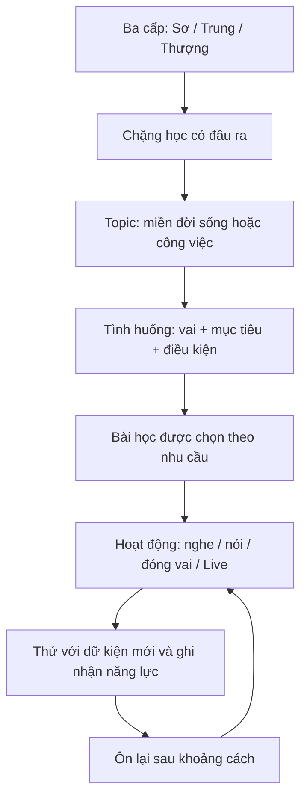

# Khung lộ trình kaiwa tự học — Sơ, Trung, Thượng

Phiên bản đề xuất: **0.1**. Đây là bản thiết kế để thống nhất trước khi biên soạn lộ trình và học liệu; chưa phải chương trình đã hoàn thiện hoặc đã thử nghiệm hiệu quả.

**Trạng thái sau phản hồi người dùng:** đề xuất này được lập trước khi có thống kê 27 sách, chưa đủ cơ sở để khóa topic/lộ trình. Giữ làm tài liệu thảo luận lịch sử; không dùng 16 topic dưới đây làm khuôn ép nguồn. Dùng [chỉ mục metadata 27 sách](catalog27/README.md) làm điểm xuất phát cho lần thiết kế tiếp theo.

**Đề xuất tiếp nối từ thống kê:** [khung hợp nhất 25 topic và tình huống sơ–trung–thượng](curriculum_outline/ROADMAP_OUTLINE.md), kèm gom nhãn và phân vai đủ 27 sách. Bản mới vẫn ở mức khung, chưa biên soạn bài học.

Giả định bản đầu dành cho người lớn Việt Nam muốn giao tiếp tiếng Nhật trong sinh hoạt, quan hệ xã hội và công việc. App có luyện phát âm theo câu, đóng vai một bên audio/một bên người học và Live Kaiwa AI. Thời lượng, số câu và lịch ôn trong tài liệu là cấu hình pilot, cần điều chỉnh từ thực tế sử dụng.

Nguồn đầu vào: [memo 22 nhóm nguồn](WEB_COURSE_TOPICS_MEMO.md), [thư viện knowledge](../knowledge/README.md), [kiểm kê 30 PDF](../clean/FINAL_INVENTORY.json), kho `bunpou_skill/` được đọc dưới dạng nguồn tham chiếu.

## 1. Quyết định cốt lõi

**Đích học là thực hiện được việc giao tiếp bằng nghe–nói.** Mỗi tình huống phải nói rõ: người học nghe ai, cần hiểu gì, cần nói/đáp ra sao và kết quả cuối là gì. Topic, từ vựng và ngữ pháp cùng phục vụ đầu ra ấy.

Không chia ba cấp thành ba tập chủ đề hoàn toàn khác nhau. Cùng một miền chủ đề có thể quay lại: gọi món đơn giản → giải thích nhu cầu và xử lý nhầm món → giải quyết bất đồng, diễn đạt tế nhị. Tăng khó bằng yêu cầu giao tiếp, không chỉ bằng câu dài hoặc từ hiếm.

Một số miền mở muộn hoặc là nhánh chọn: thương lượng chuyên môn, nuôi dạy con, quan hệ đối tác cụ thể. Người chưa cần những miền ấy vẫn có đường đi trọn vẹn qua phần giao tiếp chung.

Các sách clean tiếp tục giữ nguyên mạch và đặc trưng. Lộ trình là **lớp biên soạn mới có tham chiếu về sách**, có thể sắp xếp lại để tự học; không sửa các bản clean thành một template chung.

JF Standard thiết kế mục tiêu bằng Can-do — người học làm được gì — và liên kết mục tiêu với đánh giá. Khung này tham khảo cách tiếp cận đó; ba nhãn Sơ/Trung/Thượng của app chưa được công nhận là các mức CEFR hoặc JLPT. [Nguồn JF](https://www.jfstandard.jpf.go.jp/summary/ja/render.do).

## 2. Cấu trúc nội dung và cấu trúc buổi học

- **Cấp độ:** mô tả mức độc lập, độ phức tạp và khả năng xử lý phát sinh.
- **Chặng học:** một nhóm đầu ra để người học thấy mình tiến bộ, thay vì đi qua danh sách topic rất dài.
- **Topic:** một miền có nhiều mục tiêu, ví dụ ăn uống hoặc phối hợp công việc.
- **Tình huống:** hoàn cảnh có người nói, quan hệ, việc cần đạt, thông tin và ràng buộc cụ thể.
- **Bài học:** một bước học có mục tiêu, có thể gồm nhiều hoạt động.
- **Hoạt động:** nghe tìm thông tin, phân biệt âm, nhắc lại, nói từ gợi ý, đóng vai, Live…
- **Buổi học hằng ngày:** gói thời lượng ghép phần ôn và phần đang học. Không đồng nhất một buổi với toàn bộ một tình huống.

“Xin lỗi”, “nhờ vả”, “xác nhận”, “hỏi lại”, “kể chuyện” là các **chức năng giao tiếp dùng ở nhiều topic**. Gắn thẻ để tái sử dụng, không tạo các bản kiến thức độc lập rồi bắt học lại từ đầu mỗi lần.

## 3. Ba cấp độ cần đạt gì?

### Sơ cấp — Nghe và đáp để giải quyết việc quen thuộc

Đầu vào có thể từ zero. Đầu ra: hiểu thông tin trực tiếp trong trao đổi ngắn, tự hỏi/đáp cho nhu cầu thường gặp, biết nhờ nói chậm/nói lại và xác nhận điều quan trọng.

- Bối cảnh cụ thể; mục đích rõ; ít thông tin mới mỗi lần.
- Có mẫu và gợi ý ban đầu, sau đó giảm dần. Không bắt người học đọc được toàn bộ kanji mới cho luyện nói.
- Bước cuối cần nói được với dữ kiện đổi, không chỉ đọc lại đoạn mẫu.
- Cuối cấp có tiếp xúc công việc cơ bản: chào, hỏi cách làm, xác nhận lịch/chỉ thị, báo đến muộn, nhờ giúp đơn giản.

**Các chặng đề xuất:** khởi động nghe–nói → bản thân và trao đổi thiết yếu → sinh hoạt/đi lại → quan hệ và công việc cơ bản. Danh mục topic ưu tiên: T01–T11 và điện thoại cơ bản trong T13. Các phần đầu của T12/T14/T15/T16 tùy mục đích, không dồn đàm phán vào giai đoạn bắt đầu.

**Chặng khởi động cho zero:** nghe và tạo âm cơ bản; nhịp mora, âm dài/ngắn, âm ngắt っ, ん và âm ghép; cụm chào/tên/cảm ơn/xin nói lại. Luyện phân biệt và phát âm ngay trong lời có nghĩa. Học kana có thể song song; audio và nghĩa Việt cho phép bắt đầu nói trước khi đọc thạo. Không dành cả chặng chỉ để giảng lý thuyết âm hoặc yêu cầu đạt giọng bản ngữ trước khi vào hội thoại.

### Trung cấp — Chủ động duy trì cuộc nói chuyện và xử lý phát sinh

Đầu ra: kể trải nghiệm, giải thích hoàn cảnh/lý do, hỏi tiếp, so sánh lựa chọn, bàn phương án; xử lý được lời từ chối, hiểu nhầm hoặc thay đổi kế hoạch trong các miền quen thuộc.

- Bớt phụ đề và gợi ý; nghe nhiều cách nói cho cùng một ý.
- Người học phải chủ động mở/giữ/kết thúc chuyện, không chỉ đáp câu hỏi của AI.
- Bắt đầu chọn cách nói theo quan hệ: thân/khách sáo, đồng nghiệp/cấp trên/khách hàng.
- Biết diễn đạt lại khi thiếu từ; hỏi làm rõ thay vì bỏ cuộc.

**Các chặng đề xuất:** phát triển quan hệ và kể chuyện → tự xử lý việc đời sống → phối hợp công việc → trình bày và trao đổi quan điểm. Mở sâu T01–T16; T12 và các nhánh nghề nghiệp có thể chọn theo nhu cầu.

### Thượng cấp — Điều chỉnh sắc thái, phối hợp nhiều ý và tác động đến kết quả

Đầu ra: giải quyết việc có nhiều ràng buộc, bảo vệ quan điểm, thương lượng, nhượng bộ, phản đối/từ chối tế nhị; nghe được ý định và ứng xử phù hợp; kể chuyện và thảo luận sâu trong đời sống cũng như công việc.

- Nhiều cách trả lời đúng; cần giữ mạch, quan hệ và kết quả giao tiếp.
- Có thông tin bất ngờ và xung đột mục tiêu được thiết kế trước.
- Cần tổng hợp điều đối phương nói, làm rõ điểm chưa thống nhất và chốt bước tiếp theo.
- Không định nghĩa thượng cấp bằng việc phải dùng nhiều ngữ pháp N1. Cách nói đơn giản, tự nhiên và phù hợp vẫn đạt.

**Các chặng đề xuất:** sắc thái và quan hệ → thương lượng/xử lý vấn đề → trình bày/thảo luận sâu → nhiệm vụ tích hợp nhiều bối cảnh. Không biến cấp này thành chỉ có tiếng Nhật công sở; giữ quan hệ thân thiết, cảm xúc, văn hóa và xã hội.

## 4. Danh mục 16 topic gốc và hướng mở rộng theo cấp

Đây là **bản nháp tổ chức từ các nguồn đã gom**, chưa phải danh sách tình huống hoàn chỉnh hoặc chứng nhận level từng câu. Mỗi ví dụ dưới cần được map đến unit/câu nguồn khi biên soạn. Các tình huống chuyển bối cảnh phải được gắn nhãn biên soạn thích ứng.

### T01 — Bản thân, gia đình và cuộc sống cá nhân

- **Sơ:** tự giới thiệu và hỏi thông tin cơ bản; giới thiệu gia đình, công việc/sở thích đơn giản.
- **Trung:** kể quá trình học/làm việc và thay đổi trong cuộc sống; bàn kế hoạch gia đình, việc sống riêng/sống chung.
- **Thượng:** giải thích lựa chọn sống/nghề nghiệp; trao đổi khác biệt về giá trị, trách nhiệm và ưu tiên.
- **Đầu mối nguồn:** S02/#2–3, S05/topic-1, S06/chương-1/10, S10/bài-6, S11/bài-8. Sinh con/nuôi con là nhánh chọn từ S01/B1/10–19, không bắt mọi người học.

### T02 — Chào hỏi, làm quen và xây dựng quan hệ

- **Sơ:** chào và mở lời; giới thiệu bạn, mời/rủ, nhận lời hoặc từ chối đơn giản.
- **Trung:** hỏi tiếp về sở thích, nối câu chuyện lần trước; kể một chuyện nhỏ và đáp lại bằng sự quan tâm.
- **Thượng:** chia sẻ bất an/cảm xúc một cách phù hợp; giải quyết khó xử, duy trì quan hệ sau bất đồng hoặc từ chối.
- **Đầu mối:** S06/chương-1/2/8/9, S08/bài-6–8/11/15, S12, S21; sách các cụm phản hồi, cảm xúc trong knowledge.

### T03 — Thời gian, lịch trình và kế hoạch

- **Sơ:** hỏi giờ, lịch sinh hoạt; hẹn ngày giờ và xác nhận.
- **Trung:** đổi/hủy hẹn có lý do; cân đối lịch nhiều người, đề nghị phương án khác.
- **Thượng:** thương lượng ưu tiên khi lịch xung đột; chốt kế hoạch dự phòng và trách nhiệm khi điều kiện thay đổi.
- **Đầu mối:** S02/#33/36/42, S04/bài-9/10, S09/bài-1, S10/bài-7, S14/S15/unit-5–7.

### T04 — Nhà ở, khu phố và dịch vụ công cộng

- **Sơ:** mô tả chỗ ở, hỏi nơi có cơ sở cần dùng; hỏi/nắm quy tắc sinh hoạt.
- **Trung:** tìm và chuẩn bị chuyển nhà; thống nhất việc chung, trao đổi với cơ quan địa phương/thư viện.
- **Thượng:** thương lượng điều kiện sống chung; giải quyết phàn nàn giữa hàng xóm, bàn tổ chức hoạt động cộng đồng.
- **Đầu mối:** S01/A2/6/10/11 và B1/7–9/20–21, S04/topic-4, S06/chương-1/10, S11/bài-5, S03/#33, S19/unit-4. Thú cưng là nhánh từ S01/B1/20.

### T05 — Ăn uống, nhà hàng và các cuộc gặp bên bàn ăn

- **Sơ:** gọi món và hỏi lựa chọn; nói số lượng/mong muốn đơn giản, thanh toán.
- **Trung:** giải thích món không ăn được/yêu cầu riêng; đặt chỗ, hỏi về món và xử lý nhầm món.
- **Thượng:** nêu bất bình và thương lượng cách xử lý mà vẫn giữ quan hệ; trao đổi nhận xét, khác biệt văn hóa ăn uống trong cuộc gặp.
- **Đầu mối:** S01/A1/6, S02/#19–20/24/27, S06/chương-2/8, S10/bài-5, S11/bài-6, S19/unit-3, S22/bài-5. Một số biến thể xử lý nhầm món là hướng thích ứng cần kiểm nguồn chi tiết.

### T06 — Mua sắm, thanh toán và dịch vụ

- **Sơ:** hỏi hàng/giá, chọn món; nêu yêu cầu với nhân viên, gửi hàng.
- **Trung:** so sánh sản phẩm/dịch vụ; giải thích nhu cầu, hỏi thủ tục và xử lý vấn đề thanh toán/đổi hàng khi có nguồn phù hợp.
- **Thượng:** làm rõ điều kiện dịch vụ; đàm phán phương án xử lý khiếu nại, giải thích hoặc bác bỏ yêu cầu có lý lẽ.
- **Đầu mối:** S01/A1/2–5/7/10, A2/2–5/13; S02/#9–11/19/38, S04/topic-8, S19/unit-2, S16/bài-7. Không tự đưa quy định pháp lý/thủ tục hiện hành vào từ tên topic.

### T07 — Giao thông, du lịch và lưu trú

- **Sơ:** hỏi đường/đích tàu, mua vé; nói điểm muốn đến với tài xế, hỏi thông tin tại chỗ.
- **Trung:** giải thích hành trình và thay đổi; hỏi lựa chọn khác, trình bày vấn đề khi đi lại/lưu trú.
- **Thượng:** phối hợp hành trình nhiều ràng buộc; giải quyết gián đoạn và trình bày phương án thay thế cho nhóm.
- **Đầu mối:** S01/A1/8–9 và B1/2–3, S02/#1/6/15/21/32, S05/topic-7, S06/chương-8/10, S19/unit-1; các nguồn du lịch/lưu trú trong knowledge khi kiểm kê.

### T08 — Sức khỏe, an toàn và tình huống cần giúp đỡ

- **Sơ:** báo không khỏe, hỏi giúp; hiểu thông báo và chỉ dẫn an toàn quen thuộc.
- **Trung:** giải thích triệu chứng/diễn biến để trao đổi với nhân viên y tế; báo tai nạn/sự cố và xác nhận hướng dẫn.
- **Thượng:** giải thích tình trạng có nhiều thông tin; làm rõ hiểu nhầm hoặc phối hợp hỗ trợ, tổng hợp lại điều được hướng dẫn.
- **Đầu mối:** S01/A2/8–9/14–15, B1/4–6; S02/#25, S05/topic-8, S06/chương-5/7, S14/unit-3/9/11, S19/unit-5. Mục tiêu là giao tiếp; không tự tạo nội dung chẩn đoán/điều trị.

### T09 — Sở thích, giải trí, sự kiện và trải nghiệm

- **Sơ:** nói thích gì, rủ đi đâu; kể ngắn việc đã làm và cảm nhận.
- **Trung:** kể trải nghiệm có diễn biến; bàn lựa chọn và kế hoạch hoạt động, so sánh cảm nhận.
- **Thượng:** kể sinh động, bình luận phim/sách/nghệ thuật; trao đổi quan điểm khác nhau và duy trì câu chuyện sâu.
- **Đầu mối:** S02/#13–14/18/22–23/26/29–31/34–35/46/48, S04/topic-6/9, S05/topic-2/4/6/9, S06/chương-3/5/6/9, S20/S22 về nghệ thuật.

### T10 — Học tập, trường học và phát triển bản thân

- **Sơ:** hỏi lại lời giáo viên/bạn học; hỏi phòng học, đăng ký hoặc nhờ giúp việc học.
- **Trung:** giải thích khó khăn, xin lời khuyên; bàn mục tiêu và cách học hoặc vấn đề trong hoạt động trường.
- **Thượng:** thảo luận lựa chọn học tập/hướng đi; trình bày và phản biện quan điểm về giáo dục, hỗ trợ người khác ra quyết định.
- **Đầu mối:** S08, S01/B1/16–19/23, S02/#5/7, S22/bài-9. Nhánh phụ huynh–nhà trường tách khỏi nhánh người học/du học sinh.

### T11 — Hội nhập nơi làm việc và việc thường ngày

- **Sơ:** chào, tự giới thiệu ở chỗ làm; hỏi cách dùng thiết bị, nghe/xác nhận lịch và việc được giao.
- **Trung:** bàn giao, giải thích tiến độ/cách làm; hỏi làm rõ chỉ thị và đưa lời khuyên.
- **Thượng:** điều chỉnh cách hướng dẫn theo người nhận; xử lý chỉ thị mơ hồ, bất đồng cách làm và thống nhất mức ưu tiên.
- **Đầu mối:** S01/A1/12, A2/18–19, B1/1; S03/#11/17/28/38, S07/bài-5/6/8, S09/bài-2, S10/bài-1/2, S14/S15, S18/bài-1/4.

### T12 — Tìm việc và phát triển nghề nghiệp

- **Sơ, nhánh chọn:** nêu nghề nghiệp/kỹ năng cơ bản; hẹn hoặc hỏi thông tin tuyển dụng đơn giản.
- **Trung:** tự giới thiệu và trả lời phỏng vấn; giải thích lý do ứng tuyển, hỏi công ty và kinh nghiệm.
- **Thượng:** trình bày định hướng/chuyển nghề có lý lẽ; trao đổi điều kiện, cân nhắc cơ hội và thuyết phục bằng kinh nghiệm cụ thể.
- **Đầu mối:** S01/A2/16–17, S10/bài-7–9, S11/bài-8, S13. Những nhánh mới về điều kiện tuyển dụng cần nguồn riêng trước khi biên soạn.

### T13 — Điện thoại, hẹn gặp, tiếp khách và liên hệ đối tác

- **Sơ:** nghe/hỏi lại tên, nhận hoặc nhờ chuyển lời; hẹn gặp đơn giản.
- **Trung:** thay đổi cuộc hẹn, giải thích mục đích liên hệ; tiếp khách/đến thăm và giữ mạch xã giao.
- **Thượng:** làm rõ việc khó qua điện thoại; trì hoãn trả lời hoặc từ chối một cách phù hợp, giữ quan hệ sau cuộc trao đổi.
- **Đầu mối:** S03/#5/11/13/16/24/42/45, S09/bài-1/3/8, S17/bài-6/7, S18/bài-3/7/8; knowledge 電話応対 và business30.

### T14 — Phối hợp công việc, nhờ giúp và giải quyết vấn đề

- **Sơ, mức cơ bản:** nhờ giúp việc nhỏ, nhận/từ chối ngắn; báo đến muộn hoặc một vấn đề dễ mô tả.
- **Trung:** giải thích lý do, hạn chót và khả năng thực hiện; báo cáo sự cố, xin tư vấn và đề xuất phương án khác.
- **Thượng:** xử lý trách nhiệm/lợi ích xung đột; báo cáo tình hình nhạy cảm, thương lượng khắc phục và theo dõi kết quả.
- **Đầu mối:** S03/#14/19/23/27/29/30/36/39/40, S07/bài-1/3/9/10, S09/bài-4–7, S11/bài-4, S14/unit-10–15, S18/bài-4/5/6.

### T15 — Họp, đề xuất, thương lượng và thuyết trình

- **Sơ, chuẩn bị/nhánh chọn:** nói ý kiến đơn giản hoặc đề xuất một lựa chọn; xác nhận điểm mình hiểu trong cuộc trao đổi ngắn.
- **Trung:** báo cáo/giải thích kết quả, tham gia họp; đề xuất có lý do, hỏi và trả lời về ý tưởng.
- **Thượng:** bảo vệ/điều chỉnh lập trường, nhượng bộ; thuyết trình có cấu trúc, xử lý câu hỏi khó và chốt điều đã thống nhất.
- **Đầu mối:** S03/#3/4/8/15/21/22/37/44, S07/bài-12, S09/bài-3/9–11, S10/bài-4, S11/bài-2/6/9, S16, S17/bài-8.

### T16 — Văn hóa, xã hội và trao đổi quan điểm

- **Sơ, tiếp cận nhẹ:** giới thiệu ngắn quê hương, món ăn hoặc sự kiện quen thuộc; hỏi về điều khác lạ.
- **Trung:** giải thích tập quán, so sánh trải nghiệm; hỏi thêm và nêu cảm nhận về văn hóa/công nghệ/giáo dục.
- **Thượng:** thảo luận vấn đề có nhiều góc nhìn; tóm tắt ý người khác, đưa ví dụ/lập luận và phản biện tôn trọng.
- **Đầu mối:** S05/topic-5, S20, S22. Không bắt mọi người chọn chính trị/tôn giáo; có lựa chọn chủ đề khác để kiểm cùng kỹ năng thảo luận.

## 5. Mỗi topic phải bao phủ tình huống theo cách nào?

Không đặt mục tiêu “thật nhiều hội thoại” trước khi biết đang thiếu loại việc gì. Lập danh sách theo các chiều sau, sau đó chọn tổ hợp có ý nghĩa trong thực tế:

1. **Mục tiêu:** hỏi, nhận thông tin, yêu cầu hành động, giải thích, xử lý vấn đề, chốt quyết định…
2. **Vai/quan hệ:** bạn thân, người mới quen, nhân viên, đồng nghiệp, cấp trên, khách hàng…
3. **Diễn biến:** thuận lợi; không nghe rõ; thiếu thông tin; không có hàng/không rảnh; bất đồng; cần đổi phương án.
4. **Kênh:** trực tiếp, điện thoại/âm thanh; không coi việc đổi kênh luôn cần viết lại cả bài.
5. **Dữ kiện:** món/giá/số lượng, người/ngày giờ, đồ vật/công việc/hạn chót…
6. **Mức hỗ trợ:** có mẫu → có ý gợi ý → tự nói; đây là biến thể luyện, không phải ba tình huống mới.

Mỗi topic cần tình huống chuẩn, ít nhất một dạng phát sinh phù hợp level và một nhiệm vụ dùng lại trong bối cảnh mới. Số lượng được quyết định sau khi map nguồn; có thể thử 6–12 tình huống quan trọng/topic qua các cấp, **không ấn định mọi topic đều có cùng số lượng**. Không tạo toàn bộ tích Descartes của vai × kênh × sự cố.

### Ví dụ cụ thể: T05 ăn uống

Danh sách tình huống ứng viên: gọi món tại quầy; gọi món tại bàn và hỏi lựa chọn; hỏi thành phần/món không ăn được; đặt chỗ; món muốn gọi đã hết; món được mang ra không đúng; thay đổi đặt chỗ có ràng buộc; nêu phàn nàn và thống nhất cách khắc phục.

Sơ tập trung gọi/chọn/xác nhận; Trung giải thích yêu cầu và xử lý thay đổi; Thượng tập trung thương lượng, sắc thái và quan hệ. Cùng mục tiêu có thể có vài bản thoại và nhiều lượt luyện đổi dữ kiện; không nhân mỗi bản thoại thành một topic.

## 6. Hợp đồng cho một tình huống

Trước khi viết bài, một tình huống phải có:

- ID, topic/cấp/chặng, tên theo việc thực hiện được.
- **Can-do có thể quan sát:** ví dụ “nhờ đồng nghiệp kiểm tra báo cáo, nói hạn chót và thống nhất được phương án nếu họ đang bận”.
- Bối cảnh, hai hoặc nhiều vai, quan hệ, mục tiêu mỗi bên.
- Thông tin được biết/ẩn, dữ kiện được phép đổi, giới hạn ngôn ngữ.
- Các động tác giao tiếp cần có: mở lời → việc cần nhờ → hạn chót → đáp phản hồi → xác nhận/kết thúc.
- Những kết quả chấp nhận được, gồm cả từ chối hoặc hẹn phương án khác; không mặc định thành công là AI luôn đồng ý.
- Danh sách nghe cần hiểu, từ/cụm cần dùng, điểm kiến thức/ngữ pháp nếu cần.
- Hội thoại chuẩn, biến thể và nhánh phù hợp level.
- Gói bài/hoạt động, audio tham chiếu, thiết lập Live, cách phản hồi/đánh giá.
- Nguồn theo đơn vị nội dung, điều kiện tiên quyết và lịch ôn.

**Độ khó** mô tả bằng mức quen thuộc, số việc phải làm, lượng thông tin, quan hệ/sắc thái, mức bất ngờ, đặc điểm audio và mức hỗ trợ. Không chỉ dùng độ dài hội thoại hay nhãn ngữ pháp N mấy.

## 7. Mỗi tình huống có các loại bài học nào?

Thư viện biên soạn có tám loại; gói một tình huống thường chọn/ghép thành khoảng 4–6 bài ngắn cho pilot. Bài phức tạp có thể tách thêm. Không bắt mọi tình huống có một bài ngữ pháp riêng nếu không có điểm mới.

1. **Kiến thức tình huống:** ai nói với ai, việc cần đạt, cách mở/kết thúc, điều nên lưu ý về vai/sắc thái. Dùng ví dụ ngắn và yêu cầu người học nghe/chọn/nói, tránh một bài đọc dài.
2. **Từ vựng và cụm lời nói:** chọn từ/cụm cần để hoàn thành việc; có audio, nghĩa Việt, cách dùng trong lượt nói và yêu cầu gọi lại từ ý muốn diễn đạt. Ưu tiên cụm dùng được, không chỉ danh sách từ đơn.
3. **Ngữ pháp cần thiết, nếu có:** lấy đúng cách dùng trong bunpou đã kiểm, giải thích ngắn theo tình huống và cho nói ngay. Có đường mở bài giải thích dài hơn cho người cần.
4. **Nghe hiểu và nhận ra cách nói:** nghe mục tiêu/tình huống trước; lấy ý chính rồi chi tiết quan trọng; mở script/Việt khi cần; nghe lại với câu hỏi hoặc biến thể mới.
5. **Luyện câu và phát âm:** nghe mẫu → chia cụm khi cần → nói → phản hồi cụ thể → sửa đoạn khó → nói lại cả câu có ý nghĩa. Sau đó đổi một dữ kiện để thoát khỏi chỉ đọc theo.
6. **Đóng vai có hỗ trợ:** một vai phát audio, vai còn lại người học nói; tiến từ hiện câu → chỉ gợi ý ý nghĩa → ẩn gợi ý. Đổi vai khi có ích cho mục tiêu của người học.
7. **Live Kaiwa theo tình huống:** giữ mục tiêu/quan hệ nhưng cho diễn biến thay đổi; người học phải tự nghe, chọn ý và ứng đáp, không đối chiếu với một đáp án duy nhất.
8. **Thử thách và ôn:** làm việc tương tự với dữ kiện chưa luyện; quay lại sau khoảng cách; trộn với kỹ năng đã học ở topic khác.

Các dạng này có thể cùng nằm trong một bài học. Ví dụ một bài “nghe và mở lời” chứa kiến thức ngắn, audio và hai lượt nói; không cần tạo ba màn bài học bị ngắt rời.

Irodori online là tham khảo hữu ích về luồng mục tiêu → chuẩn bị từ → nghe/đọc và nhận ra biểu thức → thử dùng → ôn → Can-do check. Khung app ở đây bổ sung đánh giá câu nói và Live theo khả năng sản phẩm, không sao chép nguyên luồng hoặc thang điểm của Irodori. [Hướng dẫn chính thức](https://www.irodori-online.jpf.go.jp/guide/).

## 8. Một bài học diễn ra thế nào?

Khung trải nghiệm chung: **biết mình cần làm gì → nghe đầu vào → thử hiểu/nói → nhận phản hồi → thử lại với một thay đổi → ghi nhận việc làm được**.

- Mở bằng một mục tiêu gần gũi, không bằng danh sách thuật ngữ ngữ pháp.
- Hướng dẫn đủ ngắn để người tự học biết bấm/nghe/nói gì tiếp; cho nghe lại, chậm hơn hoặc xem nghĩa khi cần.
- Phản hồi cho biết vị trí và cách sửa; sau sửa quay lại nhiệm vụ giao tiếp.
- Kết thúc bằng hành động người học làm được và điều cần ôn, thay vì chỉ “đã xem hết bài”.

### Ví dụ: một tình huống Trung cấp trong T14

**Nhờ đồng nghiệp kiểm tra báo cáo và thống nhất thời hạn.** Đây là tình huống biên soạn minh họa; chưa phải một đoạn hội thoại đã trích nguyên từ sách.

- **Bài 1 — Nghe và hiểu việc cần đạt:** nghe hai diễn biến: nhận lời và đang bận. Xác định việc nhờ, thời hạn, kết quả. Giới thiệu ngắn cách mở lời và để đối phương có đường phản hồi.
- **Bài 2 — Chuẩn bị lời nói:** cụm chỉ việc cần kiểm, hạn chót, hỏi khả năng, cảm ơn/xác nhận. Chỉ đính kèm mẫu ngữ pháp khi đã tìm đúng nguồn và cách dùng; không mặc định kho N4/N5 đã có.
- **Bài 3 — Nói các lượt then chốt:** luyện câu mở lời/đề nghị/xác nhận; sửa lỗi ảnh hưởng nghĩa như số và giờ; đổi công việc hoặc hạn chót rồi tự nói lại.
- **Bài 4 — Đóng vai:** đồng nghiệp phát audio, người học nói phần nhờ và xác nhận. Bản đầu hiện câu, bản sau chỉ còn mục tiêu. Nhánh audio phải khớp việc người học thật sự nói.
- **Bài 5 — Live:** AI là đồng nghiệp có việc khác đang làm; người học phải hỏi, nghe khả năng và bàn phương án. Thành công có thể là thống nhất giờ khác, không nhất thiết ép AI làm ngay.
- **Bài 6 — Vận dụng/ôn:** đổi tài liệu/người/hạn chót; sau một khoảng cách làm lại không xem mẫu. Dùng kết quả để quyết định ôn điểm nào.

Không bắt hoàn thành sáu bài trong một buổi. Có thể phân ba buổi: hiểu/chuẩn bị → luyện câu/đóng vai → Live/vận dụng, rồi ôn theo lịch.

Đầu mối nguồn thật để đối chiếu: S07/bài-1, S03/#14/27/30, S18/bài-5. Trong knowledge business30 đã có `u-l5-kaiwa-urgent` tại PDF85, `u-l5-kaiwa-refuse` tại PDF86 và `u-l5-tanwa-refuse-1/2` tại PDF83. Những unit này có vai cấp trên; chuyển sang đồng nghiệp là **thích ứng cần rà lại cách nói**, không gắn nhãn trích nguyên nguồn.

## 9. Ba chế độ nghe–nói phải được thiết kế khác nhau

### A. Luyện câu/đọc vai theo mẫu

- Có câu tham chiếu và audio đã kiểm, người học biết đang luyện nói câu nào.
- Phản hồi về âm/cụm có vấn đề và một cách sửa có thể làm ngay; cho nghe lại bản mẫu/bản ghi của mình.
- Nếu công cụ hỗ trợ, phân tích độ rõ âm, nhịp/ngắt, trường âm/âm ngắt và ngữ điệu. Không quảng cáo khả năng chấm pitch accent hoặc từng mora nếu công cụ chưa cung cấp được.
- Nội dung ASR ghi lại không tự chứng minh phát âm đúng. Chuẩn hóa khác biệt chữ viết như kanji/kana hoặc cách ghi số trước khi so nội dung, vẫn phải giữ đúng nghĩa của số/giờ.
- Không bắt lặp vô hạn để đạt một điểm gần tuyệt đối. Sau vài lần tập trung vào lỗi chính, lưu lại để ôn và tiếp tục dùng câu trong hội thoại.

### B. Đóng vai một bên audio, một bên người học

- **Bản theo kịch bản:** luyện lượt nói đã học; chấm phát âm với câu mẫu và giúp nắm nhịp hội thoại.
- **Bản có biến thể:** đổi dữ kiện hoặc ý phản hồi; chấp nhận nhiều cách nói đúng. Chấm hoàn thành ý riêng với chấm âm.
- Audio đối phương phải khớp nhánh thực tế. Nếu người học nói “không rảnh” thì không phát tiếp câu vốn dành cho “đồng ý”. Muốn có biến thể phải có nhánh audio tương ứng hoặc chuyển sang Live.
- Giảm hỗ trợ theo tiến độ: toàn câu → ý chính → mục tiêu/vai. Có thao tác xin nghe lại hoặc xem gợi ý; ghi mức trợ giúp đã dùng.
- Không ép học hai vai có nhu cầu rất khác nhau nếu vai kia không phục vụ người học. Khi phù hợp, đổi vai giúp nghe/đáp cả hai chiều.

### C. Live Kaiwa theo nhiệm vụ

- AI biết vai, quan hệ, bối cảnh, mục tiêu, thông tin được giấu và điều kiện kết thúc.
- Người học được chọn lời nói. AI giữ phong cách và độ khó của tình huống, không tự nhảy sang chủ đề/vốn từ vượt xa bài.
- Sơ cấp dùng ít ý, có nhắc lại và gợi ý; Trung có phản hồi không thuận lợi; Thượng có bất đồng/ràng buộc nhưng vẫn nằm trong hợp đồng tình huống.
- AI phải tạo cơ hội cho người học **hỏi, mở đề tài, đề nghị hoặc chốt việc** khi đó là mục tiêu; không làm hết những việc ấy thay họ.
- Trong lúc giao tiếp, ưu tiên giữ mạch. Hỏi làm rõ ngay nếu lỗi làm hỏng nghĩa; lỗi nhỏ tập hợp phản hồi sau lượt hoặc sau nhiệm vụ. Người học có thể chủ động gọi trợ giúp.
- Kết thúc khi đạt kết quả giao tiếp hoặc cần dừng để hỗ trợ, không kéo dài chỉ để đủ phút.
- Sau phiên: trích đúng câu người học đã nói, ghi điều làm được, chọn một vài điểm quan trọng để sửa và cho thử lại. Không biến câu đã sửa thành lời người học thực sự nói trong hồ sơ.

Nếu công cụ phát âm hiện tại chỉ chấm được với câu tham chiếu, dùng nó ở A và phần theo mẫu của B. Đánh giá âm trong Live chỉ thêm khi đã có cách phân tích audio đáng tin cậy; không lấy độ khớp với một đoạn mẫu làm điểm hội thoại tự do.

## 10. Đánh giá theo hồ sơ năng lực

Theo dõi năm mặt riêng để biết cần ôn gì:

1. **Nghe hiểu:** lấy đúng việc cần làm, chi tiết quan trọng và ý phản hồi; không chỉ chọn đáp án từ script đang mở.
2. **Hoàn thành nhiệm vụ:** hỏi/đề nghị/giải thích/chốt được việc, với các kết quả hợp lệ đã xác định.
3. **Phát âm dễ hiểu:** truyền được từ và ý; nhận ra lỗi thực sự ảnh hưởng nghĩa. Điểm của công cụ là tín hiệu luyện tập, chưa phải chứng chỉ năng lực.
4. **Tương tác và mạch:** biết nghe rồi đáp, hỏi tiếp, làm rõ, sửa hiểu nhầm và kết thúc.
5. **Phù hợp vai và sắc thái:** chọn mức lịch sự, cách nhờ/từ chối/phản đối theo quan hệ và mục đích.

Council of Europe đặt trọng tâm ở khả năng nghe hiểu được thông điệp, thay vì coi tiến bộ là ngày càng giống giọng bản ngữ; thang âm vị gồm kiểm soát tổng thể, phát âm và ngữ điệu/nhịp. Đây là định hướng cho rubric, không có nghĩa app đã được chuẩn hóa theo CEFR. [Nguồn chính thức](https://www.coe.int/en/web/common-european-framework-reference-languages/phonological-competence).

### Trạng thái học đề xuất

- **Chưa có bằng chứng:** chưa thử hoặc audio không đủ rõ để đánh giá.
- **Làm được có trợ giúp:** hoàn thành khi có câu/gợi ý.
- **Làm được độc lập:** hoàn thành một biến thể chưa học thuộc, không dựa vào mẫu.
- **Vận dụng và duy trì:** làm lại được sau khoảng cách và dùng trong bối cảnh khác phù hợp.

Một câu đọc đạt điểm cao chưa đủ nâng trạng thái của cả tình huống. Cần có bằng chứng nghe–đáp và kết quả nhiệm vụ. Ngược lại, người hoàn thành việc với vài lỗi âm nhỏ vẫn được ghi nhận tiến bộ và nhận bài sửa âm riêng.

Ngưỡng số, trọng số và thời gian phản xạ cần được hiệu chỉnh bằng pilot với đánh giá của người có chuyên môn. Không đặt ngay một ngưỡng kiểu “90 điểm là lên trung cấp”. Bản ghi nhiễu, ASR không chắc hoặc độ trễ hệ thống phải dẫn tới thử lại/xác nhận, không tự kết luận người học yếu. Thời gian đáp chỉ có ý nghĩa khi tách được thời gian xử lý của hệ thống và mức hỗ trợ.

## 11. Người học mở app mỗi ngày thấy gì?

Một nút **Học hôm nay** với việc cần đạt rõ ràng; bên trong kết hợp bài đang học và ôn cũ. Có thể chọn thời lượng mà không thay đổi tiêu chí năng lực.

### Buổi tiêu chuẩn 20 phút, cấu hình pilot

- **3 phút:** nghe–đáp lại một việc cũ trước khi xem mẫu.
- **3 phút:** nghe đầu vào của mục tiêu hôm nay, tìm ý/chi tiết.
- **4 phút:** chuẩn bị hoặc sửa những câu/cụm thật sự cần dùng.
- **5 phút:** đóng vai với gợi ý giảm dần hoặc biến thể mới.
- **4 phút:** Live có mục tiêu; với người mới có thể là trao đổi rất ngắn được hỗ trợ.
- **1 phút:** xem điều đã làm được, lưu câu/lỗi cần ôn.

Đây là nhịp tham khảo, không phải sáu phần bắt buộc giống nhau mọi ngày. Ngày đầu của tình huống có thể dành thêm thời gian hiểu/chuẩn bị; ngày vận dụng dành nhiều hơn cho Live. Buổi 10 phút vẫn có nghe và nói với một mục tiêu nhỏ; buổi dài hơn thêm biến thể, không chỉ thêm giải thích.

App cần nhớ người học đang ở bước nào và nối được sau gián đoạn. Có thể mở tài liệu giải thích sâu khi muốn, nhưng không bắt đọc lại toàn bộ trước mỗi lần nói.

## 12. Ôn để nhớ và phản xạ với dữ kiện mới

- Gọi lại từ ý muốn diễn đạt hoặc lời đối phương, thay vì luôn nhìn câu Nhật rồi đọc.
- Sau khi quen mẫu, thay người/đồ vật/ngày giờ/kết quả để buộc nghe và chọn ý.
- Lặp lại chức năng ở topic khác: xin phép ở lớp → ở nơi làm việc; nhận lời/từ chối với bạn → với đồng nghiệp. Cách nói phải được rà theo quan hệ mới.
- Lịch thử ban đầu có thể là ngày 1/3/7/14 sau lần học; điều chỉnh theo kết quả và lịch người học. Đây là cấu hình sản phẩm để thử, không phải khoảng cách tối ưu đã chứng minh cho mọi người.
- Sau nghỉ nhiều ngày, có buổi khởi động lại ngắn; không xóa thành quả hoặc bắt học lại toàn bộ chỉ vì mất chuỗi ngày.
- Ghi riêng **đã hoàn thành bài**, **đã làm được việc**, **còn cần trợ giúp** và **cần ôn**.

Người đã biết một phần được thử nhiệm vụ để đi tiếp; người học không đều giữa các topic được bù điểm yếu. Đầu vào không chỉ dựa vào tự khai JLPT: có nghe và nói ngắn, phù hợp mục tiêu và mức tự tin của người học.

## 13. Lấy kiến thức từ nhiều sách và bunpou theo cách nào?

### Tách ba lớp

1. **Nguồn:** các bản knowledge và nguồn bunpou giữ nội dung/lịch sử riêng.
2. **Lộ trình:** các Can-do, topic, tình huống, điều kiện tiên quyết và đường đi.
3. **Học liệu app:** hội thoại/bài giải thích/audio/bài luyện và cấu hình Live được chọn, dịch, rút phần phù hợp hoặc thích ứng có ghi nguồn.

Không copy nguyên chương từ nhiều sách rồi nối đuôi. Chọn một mạch chính phù hợp mục tiêu; dùng sách khác để bổ sung biến thể, cách đáp, sắc thái, đối chiếu và bài luyện. Mỗi phần giữ được đường về đúng nguồn.

### Tối thiểu phải lưu cho từng phần học liệu

- Sách/nguồn, phiên bản hoặc hash, unit ID, chương, trang/block khi có.
- Vai trò của nguồn: câu/hội thoại, giải thích, ví dụ, bài tập, ghi chú văn hóa, đối chiếu.
- Quan hệ biên soạn: trích nguyên; diễn giải; bản dịch; hội thoại thích ứng; bài mới có căn cứ.
- Phần đã thay đổi: vai, nơi, dữ kiện, level, câu nói; người/tác nhân rà lại và trạng thái QA.
- Liên kết audio/script và kết quả kiểm khớp.

Một tình huống được phép dùng nhiều nguồn; một đơn vị nguồn cũng có thể phục vụ nhiều tình huống mà không nhân bản mất kiểm soát. Chỉ gom phần thực sự tương đương; giữ những khác biệt về sắc thái, quan hệ, cách từ chối/đáp và chức năng.

### Bảo toàn kiến thức toàn kho

Lập sổ ánh xạ mỗi đơn vị kiến thức vào **bài chính, biến thể luyện, ôn, tài liệu mở rộng**, hoặc **đang chờ xử lý**. Ghi rõ trường hợp tương đương đã dùng ở nơi khác. Những phần chưa có đích đến phải hiện trong backlog, không âm thầm bị bỏ vì khó đưa vào template.

Không bắt người học đi qua mọi đoạn trùng và phụ lục để được tiến cấp. Các phần hay của sách có thể trở thành nhiệm vụ kể chuyện, nghe ý định, nhận xét sắc thái, tình huống mở rộng hoặc bài tham khảo. Bản sách clean đầy đủ vẫn luôn là base đối chiếu.

Unit còn `needs_review` phải được xử lý rõ trước khi dùng làm mẫu chuẩn. Rà lại cả câu mới trong hoàn cảnh mới: chữ Nhật đúng ở một quan hệ chưa chắc phù hợp quan hệ khác. Học liệu đã thích ứng cần QA ngôn ngữ và đối chiếu hai chiều với các nguồn được dẫn.

### Tích hợp bunpou đúng vai trò

- Chọn **cách dùng cần cho tình huống**, không kéo cả bài dài có mọi cách dùng vào luồng bắt buộc.
- Lưu mẫu, nguồn/phiên bản, cách dùng được chọn, phạm vi giải thích và câu minh họa đã kiểm; giữ liên kết mở bài gốc.
- Phần ngữ pháp ngắn phải kết thúc bằng việc người học dùng nó để nói/đáp. Có thể gom cùng bài từ/cụm hoặc cho tra cứu nếu đã biết.
- Không dùng nhãn N1/N2 để tự nâng một tình huống lên thượng cấp. Mức độ nói còn phụ thuộc yêu cầu nhiệm vụ, vai, hỗ trợ và đặc điểm nghe.
- Kiểm kê tại lượt thiết kế: nguồn đang có **N1:128, N2:114, N3:118; N4:0, N5:0** ở cả bản `bunpou_skill` trong repo và bản workspace đã kiểm. Đây là số bài nguồn hiện diện, không phải kết quả kiểm ngữ nghĩa lại toàn bộ 360 bài.
- Ví dụ file thật có thể tra: `bunpou_skill/source/N3/N3_てほしい_v01.md`. Mẫu này có cách diễn đạt mong muốn và sắc thái cần chọn đúng; không tự dùng như lời nhờ lịch sự trong mọi quan hệ.
- Phần nền N4/N5 cần được kiểm kê và bổ sung bằng quy trình nguồn riêng. Trong lúc thiết kế có thể xác định ngôn ngữ cần từ sách kaiwa, nhưng phải gắn **thiếu nguồn bunpou tương ứng** nếu chưa có; không bịa link hoặc ghi “đã tích hợp”. Không sửa kho bunpou trong lượt thiết kế này.

## 14. Audio và điều kiện để một bài thực sự tự học được

Hồ sơ CD/audio hiện có của kho sách là đầu mối tra cứu; **chưa xác nhận có file nghe thực tế**. Vì vậy bản Markdown chưa tự trở thành một bài nghe–nói sẵn để phát hành.

Mỗi bài cần audio dùng được và đã kiểm khớp script, vai, tốc độ/phong cách; tách lượt nếu cần cho đóng vai. Bản thích ứng có dữ kiện khác cần audio tương ứng, không giữ file cũ mà đổi chữ. Audio được tạo mới cũng cần kiểm cách đọc, ngắt và sự tự nhiên; không coi việc tạo file thành công là QA phát âm.

Trước khi khóa thiết kế kỹ thuật, thử thực tế ba khả năng của công cụ đang có: chấm câu mẫu; đóng vai nghe–nói với các nhánh; Live với phản hồi sau phiên. Chỉ công bố những mặt điểm mà công cụ đo được. Đây là việc cần xác nhận cho pilot, chưa có kết quả thử API trong tài liệu này.

## 15. Khi nào một tình huống đủ chuẩn để đưa vào app?

- Can-do, vai, điều kiện và kết quả hợp lệ rõ ràng.
- Phụ thuộc ngôn ngữ phù hợp chặng; có đường trợ giúp và cách giảm trợ giúp.
- Nguồn truy được; không có điểm nguồn chưa giải quyết đang được dùng làm đáp án chuẩn.
- Câu Nhật, bản Việt, sắc thái và audio được rà; không thêm đoạn Nhật chỉ bằng cách dịch ngược một bản ngoại ngữ.
- Có bằng chứng kiểm nghe hiểu, nói/đáp, biến thể và Live hoặc nhiệm vụ vận dụng phù hợp.
- Các câu trả lời đúng khác mẫu được chấp nhận trong chế độ giao tiếp; lỗi mic/ASR không bị đánh đồng với lỗi người học.
- Nhánh audio và diễn biến Live đã thử: nhận lời, từ chối, hỏi lại, sai dữ kiện, dùng gợi ý, dừng/nối phiên.
- Có cấu hình ôn, ghi nhận trợ giúp và đánh giá có giới hạn rõ.

Các điều kiện này áp dụng cho **bài biên soạn mới**; không tự nâng trạng thái nghiệm thu ngữ nghĩa của toàn bộ sách clean trước đó.

## 16. Trình tự xây dựng sau khi thống nhất khung

1. Chốt các đầu ra theo cấp/chặng và phần cốt lõi/nhánh chọn. Xem 16 topic như bản nháp để so với nguồn, chưa đóng số tình huống/bài.
2. Map mục lục và unit trong 30 sách, 22 nguồn memo vào topic/chức năng/quan hệ; tách nguồn đã có toàn văn với nguồn mới có giới thiệu/mục lục.
3. Viết Can-do và ma trận bao phủ tình huống; xem phần nào thiếu nguồn, nguồn nào chưa có đích đến.
4. Pilot nhỏ trước khi biên soạn hàng loạt: có thể chọn ba miền **ăn uống, xây dựng quan hệ, phối hợp công việc**, mỗi miền một nhiệm vụ ở Sơ/Trung/Thượng. Chín nhiệm vụ là phạm vi thử đề xuất, không phải chín bài đã hoàn thành.
5. Làm đủ vòng của pilot: kiến thức cần thiết → nghe → nói/chấm câu → đóng vai → Live → thử biến thể → ôn sau khoảng cách. Kiểm đồng thời khoảng trống N4/N5 và audio.
6. Dùng kết quả người học thật và đánh giá ngôn ngữ để sửa khung, lượng bài, trợ giúp, rubric, ngưỡng và thời lượng.
7. Sau đó mới khóa cấu trúc dữ liệu/skill biên soạn để sản xuất các tình huống còn lại và đo độ phủ toàn kho.

Các câu hỏi chưa thể kết luận bằng danh sách topic: người học có chuyển được sang tình huống mới không, phản hồi phát âm có giúp sửa đúng không, Live có làm thay người học không, lượng từ mới có quá tải không và việc sau nhiều ngày còn làm được đến đâu. Pilot phải trả lời những câu này trước khi hứa thời gian “zero đến hero”.

## 17. Phạm vi đã làm trong lượt thiết kế này

Đã đọc cấu trúc memo và kho, kiểm số nguồn bunpou, xác nhận một số unit business30 làm đầu mối và đối chiếu hướng dẫn chính thức JF/Irodori/CEFR. Đã đề xuất đầu ra ba cấp, danh mục 16 topic, hợp đồng tình huống, thư viện loại bài, luồng tự học, ba chế độ nói và cách đánh giá/ánh xạ nguồn.

Chưa map toàn bộ câu/tri thức của 30 sách, chưa xác minh toàn bộ nguồn mới chỉ có mục lục, chưa thử công cụ phát âm/Live, chưa tạo audio, chưa biên soạn hoặc kiểm nghiệm chín nhiệm vụ pilot. Các quyết định trong khung là đề xuất có thể chỉnh khi thống nhất với người dùng.
